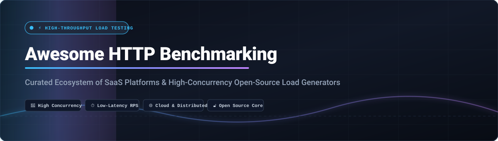
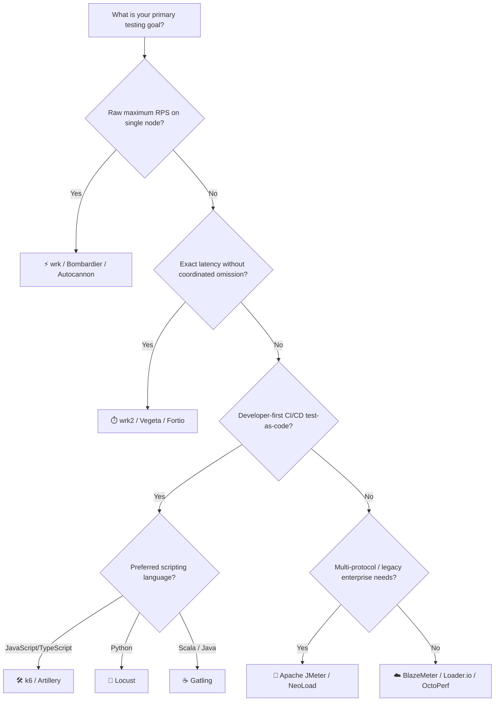

# Awesome HTTP Benchmarking 🚀

  

 

**Curated list of high-concurrency HTTP benchmarking tools, API stress testers, modern load generators, and cloud performance testing SaaS platforms.**

*Benchmark throughput (RPS), stress-test latency distributions (p99/p99.9), validate reliability, and simulate real-world traffic flows.*

**Last updated: October 2026**

---

## 📌 Overview

This repository provides an exhaustively curated guide to top **SaaS platforms** and **open-source tools** engineered for **HTTP Benchmarking**, **API load testing**, and **stress testing**. Whether you require raw single-node request generation up to hundreds of thousands of requests per second, distributed load testing across cloud clusters, or scriptable browser and protocol validation in CI/CD pipelines, this resource indexes the premier software in the ecosystem.

---

## 📑 Table of Contents

- [📊 Sector Overview & Market Dynamics](#-sector-overview--market-dynamics)
- [☁️ SaaS & Hosted Platforms](#️-saas--hosted-platforms)
- [💻 Open-Source GitHub Projects](#-open-source-github-projects)
- [💡 Choosing the Right Tool](#-choosing-the-right-tool)
- [🤝 How to Contribute](#-how-to-contribute)
- [⭐ Star History](#--star-history)
- [💖 Support & Sponsorship](#-support--sponsorship)
- [⚖️ Disclaimer](#️-disclaimer)

---

## 📊 Sector Overview & Market Dynamics

The global performance and load testing market is valued between $1.5B and $3B+ (projected to reach $6B–$7B+ by the mid-2030s at a CAGR of 11–16%). The sector is moderately to highly fragmented rather than winner-take-all, divided across massive open-source frameworks (JMeter, Gatling, k6, Locust), specialized cloud-native testing SaaS, and expanding observability/APM giants integrating synthetic load generation into unified platforms.

---

## ☁️ SaaS & Hosted Platforms

Enterprise SaaS solutions offer turnkey distributed load generation, visual scenario designers, managed cloud injector fleets, and team analytics without the overhead of maintaining server infrastructure.

| Platform | Company Scale (Valuation / Revenue) | Starting Price | Free Tier / Free Trial Limits | Description |
| --- | --- | --- | --- | --- |
| **[NeoLoad (Tricentis)](https://www.tricentis.com/products/performance-testing-neoload)** | ~$4.5B valuation (~$500M ARR; parent: Tricentis) | ~$20,000/year (enterprise licensing) | 14-day free trial limited to 10 Virtual Users (VUs) | Enterprise performance testing platform offering codeless test design, protocol coverage beyond HTTP, and AI-assisted analysis for enterprise CI/CD workflows. |
| **[Flood.io (Tricentis Flood)](https://flood.io/)** | ~$4.5B valuation (~$500M ARR; parent: Tricentis) | Historical starting tier ~$23–$49/mo (reached EOL June 30, 2024; superseded by NeoLoad) | 5 free grid node hours (1 node concurrency) historically; free trial via Tricentis NeoLoad today | Cloud load testing platform supporting JMeter, Gatling, and Selenium scripts via distributed cloud grid nodes. |
| **[BlazeMeter](https://www.blazemeter.com/)** | ~$500M+ revenue / multi-billion valuation (parent: Perforce Software) | $99/month (Basic plan, up to 1,000 VUs) | Free forever: up to 50 max VUs, 1 shared load generator, 10 tests/month, max 20 min/test | Enterprise load testing platform built on Apache JMeter, offering cloud-scale distributed testing, real-time reporting, and integrations with CI/CD and APM tools. |
| **[Loader.io](https://loader.io/)** | ~$3B valuation at acquisition / ~$111M+ ARR (parent/lineage: SendGrid / Twilio) | $99.95/month (Pro plan) | Free forever: up to 10,000 clients/users per test, 1 target host, 1-minute test duration, aggregated stats | Simple cloud-based load testing service focused on quick, ad-hoc HTTP endpoint and API checks without complex setup. |
| **[OctoPerf](https://octoperf.com/)** | Bootstrapped / Private (~$1M–$5M estimated revenue) | $69–$99/test-hour (on-demand) or from ~$649/month (unlimited subscriptions) | Free forever (Community): up to 50 concurrent VUs, unlimited tests, max 20 min/test, 1 parallel run | Load testing platform with a visual test designer and cloud execution supporting JMeter, Gatling, and Selenium scripts with full reporting. |

---

## 💻 Open-Source GitHub Projects

Open-source load generators are ranked below in descending order by GitHub Stars. Each repository includes a real-time star badge linking directly to its stargazers page.

### 1. **[wrk](https://github.com/wg/wrk)** 
* **Language / Runtime:** C
* **Overview:** **The raw single-machine throughput champion.** Combines a multithreaded design with scalable OS event notification mechanisms (`epoll`, `kqueue`) to generate staggering request volumes from minimal hardware footprint.
* **Key Features:** LuaJIT scripting engine enables dynamic request construction and custom response processing. Running `wrk -t12 -c400 -d30s` drives 12 threads and 400 connections with virtually zero internal overhead.
* **Trade-offs:** HTTP/HTTPS only; no distributed clustering out-of-the-box, no GUI, and reports service time rather than true queuing latency.
* **Best For:** Measuring absolute maximum requests per second (RPS) of a single HTTP API service.

---

### 2. **[k6 (Grafana k6)](https://github.com/grafana/k6)** 
* **Language / Runtime:** Go (ES6 JavaScript scripting engine)
* **Overview:** **The developer-centric standard for modern CI/CD load testing.** Built from the ground up for engineering teams who treat performance tests as version-controlled code.
* **Key Features:** Clean JavaScript API for modeling complex user scenarios, threshold checks, and step-load ramping. Integrates natively with Grafana dashboards, Datadog, Prometheus, New Relic, and cloud APM systems. Supports HTTP/1.1, HTTP/2, WebSocket, gRPC, and browser automation via Playwright APIs.
* **Trade-offs:** Custom JS runtime requires slight learning curve for external npm modules compared to standard Node.js.
* **Best For:** Developer-first performance pipelines, automated SLO assertions, and microservice validation in CI/CD.

---

### 3. **[Locust](https://github.com/locustio/locust)** 
* **Language / Runtime:** Python (gevent coroutines)
* **Overview:** **The Python ecosystem's premier distributed load testing tool.** Write user workflows in readable Python with arbitrary logic, loops, external SDK calls, and assertions.
* **Key Features:** Event-driven coroutines enable a single process to simulate thousands of concurrent users. Master/worker architecture scales seamlessly across distributed worker nodes to hundreds of thousands of users. Includes an interactive real-time web dashboard displaying live latency charts, error rates, and dynamic user count adjustment.
* **Trade-offs:** Raw throughput per CPU core is lower than compiled C/Go engines; best scaled across multiple cores or distributed workers.
* **Best For:** Python teams, dynamic authorization lifecycles, complex conditional user scenarios, and distributed cloud load testing.

---

### 4. **[Vegeta](https://github.com/tsenart/vegeta)** 
* **Language / Runtime:** Go
* **Overview:** **The constant-rate HTTP load testing utility and library.** Designed explicitly for drilling HTTP services at sustained, predictable request rates (e.g. constant 5,000 RPS).
* **Key Features:** Can be used either as a command-line binary with UNIX pipe composability (`vegeta attack | vegeta report`) or imported as a reusable Go library. Outputs rich terminal histogram plots and HDR latency distributions.
* **Trade-offs:** Focused primarily on fixed-rate attacking rather than complex multi-step browser user scenarios.
* **Best For:** Verifying service behavior and latency percentiles under predictable, constant request volumes.

---

### 5. **[hey](https://github.com/rakyll/hey)** 
* **Language / Runtime:** Go
* **Overview:** **The modern replacement for ApacheBench (ab).** Lightweight, single-binary CLI tool for quick, reliable HTTP benchmarking.
* **Key Features:** Supports HTTP/2, custom HTTP headers, basic authentication, proxy settings, and concurrent request worker pools. Generates a clean terminal latency distribution table and status code breakdown.
* **Trade-offs:** Single-node CLI focused on point-to-point endpoint testing without scripting scenarios.
* **Best For:** Quick terminal checks, micro-benchmarks, and verifying endpoints without complex configuration files.

---

### 6. **[Apache JMeter](https://github.com/apache/jmeter)** 
* **Language / Runtime:** Java
* **Overview:** **The protocol-agnostic veteran of enterprise load testing.** The most battle-tested open-source load testing tool in the industry with twenty+ years of production adoption.
* **Key Features:** Comprehensive visual GUI for composing intricate test trees, extractors, assertion policies, and timers. Supports exhaustive protocol stacks: HTTP, HTTPS, SOAP, REST, JDBC database queries, LDAP, JMS, FTP, and TCP. Unmatched third-party plugin ecosystem.
* **Trade-offs:** Heavy JVM thread-per-user model introduces high resource overhead; test creation UI can be steep; distributed clustering requires manual coordination.
* **Best For:** Enterprise test suites, multi-protocol testing beyond HTTP, and legacy QA team workflows.

---

### 7. **[Artillery](https://github.com/artilleryio/artillery)** 
* **Language / Runtime:** TypeScript / Node.js
* **Overview:** **Cloud-native, serverless load testing platform.** Test HTTP APIs, GraphQL, WebSocket, Socket.io, and browser journeys using declarative YAML configurations.
* **Key Features:** Serverless distributed execution directly on AWS Lambda, AWS Fargate, or Kubernetes via `artillery run-fargate`. Supports Playwright browser tests to measure Core Web Vitals and frontend user experience under peak load.
* **Trade-offs:** Heavy load generation on a single machine is bounded by Node.js V8 execution limits unless offloaded to serverless workers.
* **Best For:** Serverless cloud execution, DevOps teams testing full-stack web applications, and GraphQL/WebSocket APIs.

---

### 8. **[Autocannon](https://github.com/mcollina/autocannon)** 
* **Language / Runtime:** Node.js
* **Overview:** **Ultra-fast HTTP/1.1 benchmarking tool written in Node.js.** Inspired by `wrk` with 100% JavaScript and Node.js ergonomics.
* **Key Features:** Supports HTTP pipelining, rate limiting, dynamic request payloads, and programmatic Node.js API usage. Capable of generating over 100,000+ requests per second on modern hardware despite being written in JavaScript.
* **Trade-offs:** HTTP/1.1 focused; doesn't simulate full distributed browser sessions.
* **Best For:** Node.js developers benchmarking microservices, Fastify/Express applications, and local API servers.

---

### 9. **[Gatling](https://github.com/gatling/gatling)** 
* **Language / Runtime:** Scala / Java / Kotlin / TypeScript
* **Overview:** **The high-efficiency non-blocking DSL framework.** Built on Netty and asynchronous IO to simulate tens of thousands of virtual users per machine without thread exhaustion.
* **Key Features:** Expressive, code-as-configuration DSL available in Java, Kotlin, Scala, and TypeScript. Generates comprehensive, interactive HTML reports with detailed latency percentiles (p50, p95, p99), response times, and failure distributions.
* **Trade-offs:** JVM dependency; DSL requires an initial learning investment.
* **Best For:** High-volume user simulation, complex stateful scenarios, and CI/CD-driven performance regressions.

---

### 10. **[Bombardier](https://github.com/codesenberg/bombardier)** 
* **Language / Runtime:** Go
* **Overview:** **Fast cross-platform HTTP benchmarking CLI tool.** Written in Go using `fasthttp` and standard `net/http` clients.
* **Key Features:** Supports both standard Go HTTP client and ultra-fast `fasthttp`, allowing developers to isolate framework overhead. Simple command line flags for connection concurrency, duration, timeout, and rate-limiting.
* **Trade-offs:** Focused on single-URL benchmarking; lacks scenario scripting or distributed worker coordination.
* **Best For:** Cross-platform single-binary benchmarking across Windows, Linux, and macOS.

---

### 11. **[Siege](https://github.com/JoeDog/siege)** 
* **Language / Runtime:** C
* **Overview:** **Classic multi-threaded HTTP load testing and benchmarking utility.** An open-source staple for Unix/Linux sysadmins since the early days of web server benchmarking.
* **Key Features:** Reads lists of URLs from a file (`urls.txt`) to hit diverse application paths randomly or sequentially. Supports basic authentication, cookies, transaction logging, and proxy handling.
* **Trade-offs:** Legacy threading architecture scales less efficiently on modern multicore servers than `epoll`/event-driven engines like `wrk`.
* **Best For:** Sysadmins and developers stress-testing static web servers and running ad-hoc hit lists against web clusters.

---

### 12. **[wrk2](https://github.com/giltene/wrk2)** 
* **Language / Runtime:** C
* **Overview:** **Constant-throughput variant of wrk with coordinated omission correction.** Developed by Gil Tene to measure true client-experienced latency under sustained load.
* **Key Features:** Enforces strict constant throughput rates (`-R` parameter) and accurately captures latency percentiles (up to p99.999) without falling victim to coordinated omission, where slow responses stall subsequent requests and distort latency measurements.
* **Trade-offs:** Fixed constant-rate mode requires choosing target throughput beforehand; maximum throughput capacity per thread is lower than original wrk.
* **Best For:** High-precision latency analysis, SLA/SLO verification, and preventing misleading tail-latency metrics.

---

### 13. **[Fortio](https://github.com/fortio/fortio)** 
* **Language / Runtime:** Go
* **Overview:** **Fast, resilient microservice load tester and echo server.** Originally created as the benchmarking tool for Istio service mesh performance evaluations.
* **Key Features:** Runs as a CLI, standalone Go library, or embedded daemon with an interactive web UI. Supports specified queries-per-second (QPS), records rich latency histograms, and includes specialized gRPC and TCP load testing modules.
* **Trade-offs:** Optimized for cloud-native microservices and service mesh telemetry rather than multi-page end-user browsing flows.
* **Best For:** Kubernetes service mesh benchmarking, gRPC testing, and microservice infrastructure validation.

---

## 💡 Choosing the Right Tool

---

## 🤝 How to Contribute

Contributions are warmly welcomed! Please follow these simple guidelines:

1. 🍴 **Fork the repository** to your personal GitHub account.
2. 🌿 **Create a new branch** (`git checkout -b add-tool-name`).
3. 📝 **Add or update the entry** in `README.md` keeping formatting consistent and descriptions factual.
4. ⭐ Include links to official repositories or homepages.
5. 🚀 **Submit a Pull Request** with a brief summary of the addition.

---

## 📈 Star History

---

## 💖 Support & Sponsorship

If you find **Awesome HTTP Benchmarking** valuable for your performance testing work, please consider supporting the project:

- ⭐ **Star this repository** to help others discover it.
- 🍴 **Fork and share** with colleagues and DevOps teams.
- ☕ **Buy a coffee or sponsor ongoing maintenance** via the [GitHub Sponsors Dashboard](https://github.com/sponsors/ishandutta2007).

Your support keeps this curated ecosystem updated with the latest benchmarks, platforms, and testing methodologies!

---

## ⚖️ Disclaimer

- This is a **community-curated** list — not an exhaustive index and not a commercial endorsement.
- **Tool choice depends on your inquiry**: `wrk` answers maximum RPS on single bare metal; `k6` and `Gatling` answer whether systems satisfy real-world user flows and CI/CD SLOs; `JMeter` satisfies multi-protocol compliance; `Locust` affords dynamic Python scripting flexibility.
- **Latency measurement caveat**: Standard `wrk` measures service time under current server capacity. For accurate latency percentiles during queuing, prefer `wrk2` or `Vegeta`.
- **Hardware boundaries**: Client machine bandwidth, TCP socket reuse (`TIME_WAIT`), and OS file descriptor limits often become the bottleneck before the remote server buckles. Always profile client resource utilization during tests.

---

  <b>Built for performance engineers, SREs, and developers who demand rock-solid scalability.</b>

